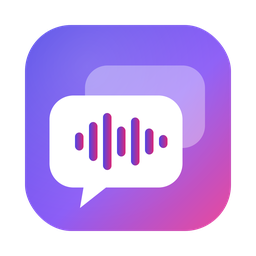

<p align="center">
  
</p>

<h1 align="center">Cadence</h1>

<p align="center">
  <b>Local meeting transcription for macOS that knows who said what.</b><br>
  Teams, Zoom, Meet, Webex or any browser call. No bot in the meeting and no cloud.
</p>

<p align="center">
  <a href="https://github.com/robinvonmises/cadence/releases/latest"></a>
  
  
  
</p>

> The interface is available in **English and German**. It follows your Mac's language, and you can switch it in *Settings → General*. Transcription handles German, English and automatic language detection. 🇩🇪 [Deutsche Fassung dieser README](README.de.md)

---

Cadence records your meeting app's audio and your microphone as **two separate tracks**. It transcribes both **on your Mac** with Whisper and puts a name and a party on every sentence. You tag speakers live with one click or a global hotkey, and Cadence recognizes voices it already knows while the call is still running. After the call, it separates the voices, spreads your tags across the whole conversation, remembers the voices for next time and writes a summary with decisions and action items.

## Highlights

| | |
|---|---|
| 🎙️ **Two tracks** | Microphone = you, system audio = everyone else. Your own lines are always attributed correctly. |
| 🧩 **Any meeting app** | "All apps" works with everything. You can also capture a single app, including helper processes such as the Teams WebView. |
| 📝 **On-device transcription** | [WhisperKit](https://github.com/argmaxinc/WhisperKit) on the Neural Engine with Large v3 Turbo by default. Runs live during the call in German, English or auto-detect. |
| 👥 **Prepare participants** | Add people per party before the call: your company, the customer, partners. Names are suggested from earlier meetings, and "copy participants from…" handles recurring meetings. An internal-meeting template uses a single party. |
| 🗣️ **Who's talking?** | Click a name, press **⌃⌥1–9** (works while Teams is in front), or type a new name. Every unknown bubble shows the participants as chips, so one click answers "Who was that?" for that turn and everything after it. |
| ⚡️ **Live voice recognition** | New in 0.2. During the call, [SpeakerKit](https://github.com/argmaxinc/WhisperKit) (pyannote, on-device) separates the voices every few seconds. Known voices get their name right away, and one tag is enough to label a voice for the rest of the call. |
| 🧠 **Speaker diarization** | After the call, SpeakerKit runs again over the whole recording. Each voice gets the person you tagged most often, so one or two tags per person are enough. |
| 🔊 **Voice profiles** | Voices you've assigned are stored locally as voice fingerprints. In later meetings, known voices are filled in automatically. |
| ✨ **Summary & action items** | New in 0.2. After the call, Apple Intelligence writes a short summary with key points, decisions and action items, fully on-device. Tick off tasks in the app, copy the summary, or find it in the minutes. Requires macOS 26 with Apple Intelligence. |
| 📇 **People** | All participants in one place: rename, set party or company, add a note, merge duplicates, forget a voice or delete a person. |
| 🎚️ **Microphone options** | Pick the input device, or switch your microphone off to transcribe a podcast or video. Cadence warns you if a track stays silent. |
| ⭐️ **Markers & notes** | Highlight, to-do, decision or free note, each with a timestamp. Add them live by hotkey or from any sentence afterwards. |
| 📋 **Copy & export** | Copy the conversation with or without speakers and with or without timestamps (⇧⌘C). Export as Markdown transcript, meeting minutes, JSON, SRT or plain text. |
| 🛡️ **Consent** | A reminder before every recording, with a message you can paste into the meeting chat. The confirmation is logged in the minutes. |
| 💾 **Plain files** | One folder per meeting with `session.json`, `transkript.md`, `protokoll.md` and audio (`mikrofon.m4a`, `system.m4a`, `gesamt.m4a`). |

## Install

1. Download **Cadence.zip** from the [latest release](https://github.com/robinvonmises/cadence/releases/latest) and move `Cadence.app` to *Applications*.
2. The build is **not notarized** yet, so the first launch is blocked. Right-click the app and choose **Open**, or run:
   ```bash
   xattr -dr com.apple.quarantine /Applications/Cadence.app
   ```
3. On first launch Cadence downloads the speech model, about 1.6 GB, once. Smaller models are available in Settings.

**Requirements:** macOS **14.4** or later, which provides Core Audio process taps. Apple Silicon is strongly recommended. Summaries need macOS 26 with Apple Intelligence turned on. Everything else works without it.

### Permissions

| Permission | Why | Where |
|---|---|---|
| **Microphone** | your track | asked on first start, or *System Settings → Privacy & Security → Microphone* |
| **System audio recording** | the meeting app's sound | asked on first recording, or *Privacy & Security → Screen & System Audio Recording → "System Audio Recording Only"* |

Cadence uses macOS Core Audio process taps, so it needs **no screen recording**. You keep hearing everything as usual. Global hotkeys need **no** Accessibility permission. Headphones are recommended. Without them, there's an echo-cancellation toggle in Settings.

## Using it in a meeting

1. Enter a title, pick the source ("All Apps" is almost always right) and the language, and add participants on the right. Start with a click or **⌘⏎**.
2. Confirm consent.
3. When someone speaks, click their name or press **⌃⌥1–9**. Or click their chip under an unassigned bubble ("Who was that?"). With live voice recognition on, the voice keeps that name for the rest of the call. **⌃⌥N** brings Cadence to the front to type a new name.
4. **⌃⌥M / A / E** marks a highlight, to-do or decision.
5. **Stop**: Cadence finishes transcribing, separates the voices, recognizes known ones, writes the summary and saves everything.
6. Check "Detected voices" in the side panel and the summary above the transcript, then copy or export.

| Shortcut | Action |
|---|---|
| ⌃⌥1 … 9 | Person *n* is speaking (order of the participant list) |
| ⌃⌥0 | Unknown speaker |
| ⌃⌥N | Bring Cadence to the front and type a new name |
| ⌃⌥M / A / E | Highlight / to-do / decision |
| ⌃⌥R | Stop recording |
| ⇧⌘C | Copy conversation with speakers and timestamps |
| ⌘1 … 9, ⌘0, ⌘M, ⌘. | Same as above while Cadence is in front |

## Build from source

```bash
git clone https://github.com/robinvonmises/cadence.git
cd cadence
./scripts/build-app.sh          # Release build → build/Cadence.app (ad-hoc signed)
open build/Cadence.app
```

- Sign with your own certificate so that macOS keeps your permissions across rebuilds:
  `CODESIGN_IDENTITY="Apple Development: Your Name (TEAMID)" ./scripts/build-app.sh`
- If the repo lives in a synced folder (iCloud, Nextcloud, Dropbox), keep build output elsewhere:
  `SCRATCH_PATH=~/Library/Caches/cadence-build APP_DIR=~/Applications ./scripts/build-app.sh`
- To work in Xcode, run `brew install xcodegen && xcodegen` (see `project.yml`).
- Tests: `swift test --filter CadenceCoreTests` covers speaker resolution, chunking, export, copy text and voice matching.

Every push is built by GitHub Actions on macOS 15. The zipped app is attached as a workflow artifact.

## How it works

```
Tap / mic ──► 48 kHz mono ──► M4A tracks
          └─► 16 kHz ──► energy VAD chunks ──► WhisperKit ──► segments ──► SpeakerResolver
          └─► live: ~20 s windows ──► SpeakerKit ──► LiveSpeakerRegistry ──► stable voices
                                  after stop: SpeakerKit ──► clusters + voice embeddings
                                                        └─► Apple Foundation Models ──► summary
```

Speaker attribution is recomputed on every change. The priority order is: manual assignment, then voice cluster, then live hotkey tag, then microphone owner. During the call, each short diarization window has its own cluster numbers. The live registry maps them to stable voices for the whole call by comparing voice embeddings. Voice profiles store one embedding per meeting and person. They are matched by cosine similarity with a deliberately conservative threshold, which leaves a voice unassigned rather than guessing wrong.

```
Sources/
├── CadenceCore/        platform-independent, unit-tested
│   ├── Models.swift          Session, Party, Person, TranscriptSegment, SpeakerTag, Marker
│   ├── SpeakerResolver.swift mic + live tags + diarization clusters → person
│   ├── VoiceProfiles.swift   voice fingerprints, matching, learning
│   ├── SpeechChunker.swift   energy VAD: audio → speech chunks for Whisper
│   ├── SessionEditing.swift  assign, rename, markers …
│   └── Exporters.swift       Markdown, minutes, JSON, SRT, text, copy variants
└── Cadence/            macOS app (SwiftUI)
    ├── Audio/              Core Audio process tap, microphone, M4A, mixdown
    ├── Transcription/      WhisperKit + SpeakerKit
    ├── Storage/            one folder per meeting, voice profile store
    ├── Hotkeys/            system-wide hotkeys (Carbon)
    └── Views/              start screen, live view, review, settings, menu bar
```

## Privacy

Everything stays on your Mac: audio, transcripts, summaries, people and voice profiles (`~/Library/Application Support/Cadence/`). Summaries use Apple's on-device model. The only network access is the one-time model download from Hugging Face.

## Roadmap

- [x] English user interface (0.2)
- [x] Live diarization and live voice recognition during the call (0.2)
- [x] Local summaries and action items with Apple Foundation Models (0.2)
- [ ] Calibrate the voice-matching threshold on real meetings
- [ ] Summaries on Macs without Apple Intelligence (e.g. MLX)
- [ ] Calendar integration: title and participants from the event, auto-start when a call begins
- [ ] Echo de-duplication without headphones
- [ ] Pause/resume, custom vocabulary prompt for Whisper
- [ ] Notarized builds and Sparkle updates

## Legal note

Recording conversations without consent is illegal in many jurisdictions. In Germany it is a criminal offence under § 201 StGB, and the GDPR applies to personal data. Cadence reminds you to ask before every recording and logs the confirmation, but the responsibility is yours.
